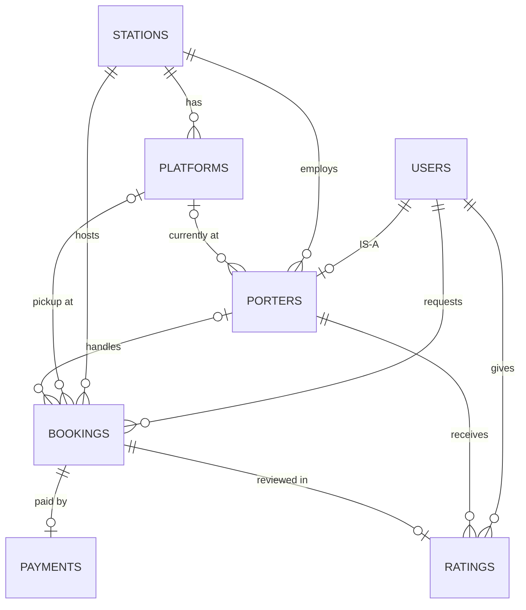

# RailPort – Railway Station Porter Booking & Management System
**Course:** 23AIE303 – Database Management Systems | **Final Project Report** | **Team 8**

## 1. Project Title and Team Details

**Project title:** RailPort – Railway Station Porter Booking and Management System

| S.No | Name | Roll Number |
|---|---|---|
| 1 | Suraj B | CB.SC.U4AIE24105 |
| 2 | Sai Karthik C | CB.SC.U4AIE24107 |
| 3 | Virinchi Sai Ch | CB.SC.U4AIE24158 |
| 4 | Jatin Chandra Gupta K | CB.SC.U4AIE24162 |


---

## 2. Project Overview, Introduction and Problem Statement

### 2.1 Overview
RailPort is a database-driven web application for booking luggage porters at railway stations. A passenger raises a request (train, coach, luggage count, destination, pickup platform); a porter of that station accepts it, completes the job, the fare is paid by CASH / UPI / CARD, and the passenger gives a 1–5 star rating. Administrators manage stations, platforms, users and monitor the data. The PostgreSQL database has **7 tables** (users, stations, platforms, porters, bookings, payments, ratings) and is accessed through a Node.js/Express REST API and a React front end.

### 2.2 Introduction
Porters are an important part of Indian railway travel, but the service is still informal: finding a porter means searching a crowded platform, the fare is negotiated on the spot, and there is no record of the service, payment or quality. RailPort moves this process into a relational database so that every request, assignment, payment and review is stored, constrained and queryable.

### 2.3 Problem Statement
To design and implement a normalized relational database and a web application that allows passengers to request luggage assistance, porters to accept and complete requests, and the system to record fares, payments and ratings – making the process transparent, traceable and data-driven.

### 2.4 Objectives
- Model passengers, porters, admins, stations and platforms in a normalized (BCNF) schema.
- Track the booking life cycle: `REQUESTED → ACCEPTED → IN_PROGRESS → COMPLETED / CANCELLED`.
- Record one payment and one rating per booking.
- Enforce integrity in the database itself (PK, FK, UNIQUE, CHECK, NOT NULL, DEFAULT, ON DELETE CASCADE).
- Provide a secure REST API (parameterized queries, bcrypt hashes) and a CRUD front end.
- Demonstrate advanced SQL (joins, subqueries, aggregates, window functions, CTEs, views, triggers, procedures, transactions).

### 2.5 Users and roles
| Role | Responsibilities |
|---|---|
| PASSENGER | Register, create bookings, pay, rate the porter |
| PORTER | Has badge number, home station, availability (AVAILABLE/BUSY/OFFLINE), current platform; accepts and completes bookings |
| ADMIN | Manages users, stations, platforms; monitors bookings and payments |

---

## 3. System Requirements and Architecture

### 3.1 Functional requirements
1. User registration and login (passwords stored as bcrypt hashes).
2. CRUD on users, stations, platforms, porters, bookings, payments, ratings.
3. Passenger creates a booking; unassigned bookings (`porter_id IS NULL`) are listed for porters.
4. Porter accepts a booking, status changes through the life cycle, porter availability is updated.
5. Payment recorded per booking (method, status, transaction id).
6. One rating (1–5 stars + review) per completed booking.
7. Filtering of bookings by passenger, porter, status.

### 3.2 Non-functional requirements
- **Integrity:** constraints enforced by the DBMS, not only by application code.
- **Security:** parameterized queries (`$1, $2 …`) against SQL injection; hashed passwords; CORS configured.
- **Performance:** indexes on foreign keys used in joins (`idx_bookings_passenger`, `idx_bookings_porter`, `idx_bookings_station`, `idx_porters_station`, `idx_platforms_station`); connection pooling.
- **Maintainability:** one route + controller per table; a generic, configuration-driven React CRUD component.

### 3.3 Hardware and software requirements
| Item | Requirement |
|---|---|
| Hardware | Any PC/laptop able to run a modern browser, Node.js and PostgreSQL (≥ 4 GB RAM recommended) |
| Database | PostgreSQL (`railport_db`), scripts `schema.sql` then `seed.sql` |
| Backend | Node.js, Express, `pg` (connection pool), `dotenv`, `cors`, `bcrypt` |
| Frontend | React with Vite, Axios |
| Tools | Any modern browser, Postman/curl for API testing, Git/GitHub |

### 3.4 Architecture
Three-tier architecture: React front end ⇄ Express REST API ⇄ PostgreSQL.


| Resource | Endpoint | Operations |
|---|---|---|
| Users, Stations, Platforms, Porters, Bookings, Payments, Ratings | `/api/<resource>` | `POST /`, `GET /`, `GET /:id`, `PUT /:id`, `DELETE /:id` |
| Bookings filters | `/api/bookings?passenger_id=&porter_id=&status=&unassigned=true` | dynamic `WHERE` built with parameters |

---

## 4. ER Diagram and UML Diagram

### 4.1 Entities and relationships
| Entity set | Type | Key |
|---|---|---|
| USERS | Strong, super-class | user_id |
| PORTERS | Sub-class of USERS (specialization) | porter_id, user_id (1:1) |
| STATIONS | Strong | station_id, station_code |
| PLATFORMS | **Weak** (identified by station + platform number) | (station_id, platform_number) |
| BOOKINGS | Associative entity (resolves Passenger ↔ Porter M:N) | booking_id |
| PAYMENTS | Dependent on booking | payment_id, booking_id |
| RATINGS | Dependent on booking | rating_id, booking_id |

| Relationship | Between | Cardinality | Participation |
|---|---|---|---|
| requests | Passenger – Booking | 1 : N | Booking total |
| handles | Porter – Booking | 1 : N | Booking partial (porter assigned later) |
| hosts | Station – Booking | 1 : N | Total |
| pickup at | Platform – Booking | 1 : N | Partial |
| has (identifying) | Station – Platform | 1 : N | Platform total |
| IS-A | User – Porter | 1 : 1 | Porter total |
| employs | Station – Porter | 1 : N | Total |
| currently at | Platform – Porter | 1 : N | Partial |
| paid by | Booking – Payment | 1 : 1 | Payment partial |
| reviewed in | Booking – Rating | 1 : 1 | Rating partial |
| gives | Passenger – Rating | 1 : N | Total |
| receives | Porter – Rating | 1 : N | Total |

**Attribute types:** *derived* – `porters.rating`, `stations.number_of_platforms`; *optional (NULL)* – `email`, `porter_id`, `pickup_platform_id`, `completed_at`; no multivalued or composite attributes needed.

### 4.2 ER diagram


GitHub-renderable version:



### 4.3 UML class diagram
Passenger and Admin are roles of `User` (`role` attribute); only `Porter` has extra attributes, so it is the only sub-class. Station–Platform is a composition (a platform cannot exist without its station).


---

## 5. Relational Schema Mapping

### 5.1 Mapping rules applied
| E-R construct | Rule | In RailPort |
|---|---|---|
| Strong entity | Table, key becomes PK | users, stations |
| Weak entity | PK = owner key + partial key; FK with CASCADE | platforms |
| 1 : N | FK on the N side | bookings.passenger_id, porters.station_id |
| 1 : 1 | FK + UNIQUE | porters.user_id, payments.booking_id, ratings.booking_id |
| M : N | New table with both FKs | bookings (passenger ↔ porter) |
| Specialization | Sub-class table keyed by super-class key | porters(user_id) |
| Derived attribute | Kept deliberately (denormalization) | rating, number_of_platforms |

### 5.2 Relational schema (`*` = primary key, `#` = foreign key)
```
users(*user_id, name, phone, email, password, role, created_at)
stations(*station_id, station_name, station_code, city, number_of_platforms)
platforms(*platform_id, #station_id, platform_number)
porters(*porter_id, #user_id, #station_id, badge_number, availability_status, #current_platform_id, rating)
bookings(*booking_id, #passenger_id, #porter_id, #station_id, #pickup_platform_id, train_number, coach_number,
         luggage_count, destination, fare, status, created_at, completed_at)
payments(*payment_id, #booking_id, amount, payment_method, payment_status, transaction_id, payment_time)
ratings(*rating_id, #booking_id, #passenger_id, #porter_id, stars, review, created_at)
```


### 5.3 Keys and constraints per table
| Table | Primary key | Other candidate keys | Foreign keys | Main CHECKs |
|---|---|---|---|---|
| users | user_id | phone, email | – | role ∈ {PASSENGER, PORTER, ADMIN} |
| stations | station_id | station_code | – | number_of_platforms > 0 |
| platforms | platform_id | (station_id, platform_number) | station_id → stations (CASCADE) | platform_number > 0 |
| porters | porter_id | user_id, badge_number | user_id → users (CASCADE); station_id → stations; current_platform_id → platforms | availability ∈ {AVAILABLE, BUSY, OFFLINE}; 0 ≤ rating ≤ 5 |
| bookings | booking_id | – | passenger_id → users; porter_id → porters; station_id → stations; pickup_platform_id → platforms | luggage_count > 0; fare ≥ 0; status ∈ {REQUESTED, ACCEPTED, IN_PROGRESS, COMPLETED, CANCELLED} |
| payments | payment_id | booking_id | booking_id → bookings (CASCADE) | amount ≥ 0; method ∈ {CASH, UPI, CARD}; status ∈ {PENDING, SUCCESS, FAILED} |
| ratings | rating_id | booking_id | booking_id → bookings (CASCADE); passenger_id → users; porter_id → porters | stars BETWEEN 1 AND 5 |

**Delete behaviour:** deleting a booking removes its payment and rating; deleting a station removes its platforms (but is blocked while porters/bookings still reference it); deleting a user who has bookings is blocked.

---

## 6. Normalization and Functional Dependencies

### 6.1 Functional dependencies
| Relation | Candidate keys | FDs |
|---|---|---|
| users | user_id, phone, email | user_id → name, phone, email, password, role, created_at; phone → user_id; email → user_id |
| stations | station_id, station_code | station_id → station_name, station_code, city, number_of_platforms; station_code → station_id |
| platforms | platform_id, (station_id, platform_number) | platform_id → station_id, platform_number; (station_id, platform_number) → platform_id |
| porters | porter_id, user_id, badge_number | porter_id → all other attributes; user_id → porter_id; badge_number → porter_id |
| bookings | booking_id | booking_id → all other attributes |
| payments | payment_id, booking_id | payment_id → all; booking_id → all |
| ratings | rating_id, booking_id | rating_id → all; booking_id → all |

### 6.2 Normal-form analysis
- **1NF:** all values atomic, every table has a primary key, no repeating groups.
- **2NF:** partial dependencies need a composite key. The only composite key is (station_id, platform_number) in `platforms`, which has no non-prime attribute → 2NF holds everywhere.
- **3NF / BCNF:** in every relation each determinant is a candidate key → no transitive dependencies; BCNF holds.
- **4NF:** no multivalued dependencies (no table stores two independent multi-valued facts).

| Relation | 1NF | 2NF | 3NF | BCNF | 4NF |
|---|---|---|---|---|---|
| users | ✓ | ✓ | ✓ | ✓ | ✓ |
| stations | ✓ | ✓ | ✓ | ✓ | ✓ |
| platforms | ✓ | ✓ | ✓ | ✓ | ✓ |
| porters | ✓ | ✓ | ✓ | ✓ | ✓ |
| bookings | ✓ | ✓ | ✓ | ✓ | ✓ |
| payments | ✓ | ✓ | ✓ | ✓ | ✓ |
| ratings | ✓ | ✓ | ✓ | ✓ | ✓ |

> Normal forms belong to whole relations (tables), not to individual rows or columns; the column dependencies decide the form.

### 6.3 Worked decomposition (0NF → BCNF)
```
BOOKING_ALL(booking_id, passenger_id, passenger_name, passenger_phone,
            porter_id, porter_name, badge_number,
            station_id, station_name, city, fare, payment_method)
FDs: booking_id → all;  passenger_id → passenger_name, passenger_phone;
     porter_id → porter_name, badge_number;  station_id → station_name, city
```
Key = `booking_id` (2NF holds). 3NF is violated by transitive dependencies such as `booking_id → passenger_id → passenger_name`. Anomalies: cannot add a station without a booking (insertion), deleting a porter's only booking loses the porter (deletion), changing a city needs many row edits (update). **Decomposition:** users, porters, stations, bookings (+ payments, ratings) – the RailPort schema. It is **lossless** (common attribute is a key of one side) and **dependency preserving**.

### 6.4 Redundancy and deliberate denormalization
| Redundant attribute | Derivable from | Treatment |
|---|---|---|
| stations.number_of_platforms | COUNT of platforms | Kept as declared capacity (seed: 12 declared vs 5 stored for MAS) |
| porters.rating | AVG(ratings.stars) | Kept for speed; refreshed by trigger Q12 |
| ratings.porter_id / passenger_id | bookings via booking_id | Kept for fast per-porter queries |
| payments.amount | bookings.fare | Kept so a payment is self-contained |
| bookings.station_id | platform of pickup_platform_id | Kept because pickup platform may be NULL |

These are redundancies *between* tables, not inside one table, so every relation is still in BCNF.

---

## 7. Methodology and Database Design

### 7.1 Methodology
| Phase | Work done |
|---|---|
| 1. Requirements analysis | Identified actors (passenger, porter, admin), places (station, platform) and transactions (booking, payment, rating). |
| 2. Conceptual design | E-R model with 7 entity sets, 12 relationships, specialization of User into Porter, weak entity Platform. |
| 3. Logical design | Reduction to 7 relations; FDs identified; normalized to BCNF. |
| 4. Physical design | PostgreSQL types, SERIAL surrogate keys, CHECK domains, 5 indexes on join columns. |
| 5. Implementation | `schema.sql` (tables in dependency order), `seed.sql` (sample data), Express API (route + controller per table), React CRUD UI. |
| 6. Testing | Sample data (3 stations, 11 platforms, 5 users, 2 porters, 2 bookings, 1 payment, 1 rating) and the queries in Section 8. |

### 7.2 Design decisions
- **Entity vs attribute:** station and platform are entities because they have their own attributes and relationships.
- **Booking as an entity:** it resolves the passenger–porter M:N and carries fare, status and times.
- **Optional `porter_id`:** a booking exists before any porter accepts it.
- **Surrogate keys + natural UNIQUE keys:** SERIAL ids as PKs; `phone`, `email`, `station_code`, `badge_number` kept UNIQUE.
- **Domain integrity with CHECK:** roles, statuses, payment methods, rating range, positive counts.
- **Referential actions:** CASCADE only where the child has no meaning without the parent (platform, porter profile, payment, rating).
- **Security in code:** parameterized queries, `COALESCE($n, column)` for partial updates, `RETURNING *` for inserts/updates.

### 7.3 Sample data used
| Table | Rows | Example |
|---|---|---|
| stations | 3 | Chennai Central (MAS), Chennai Egmore (MS), Coimbatore Junction (CBE) |
| platforms | 11 | MAS 1–5, MS 1–3, CBE 1–3 |
| users | 5 | 2 passengers, 2 porters, 1 admin |
| porters | 2 | MAS-P001 (AVAILABLE), MAS-P002 (BUSY) |
| bookings | 2 | #1 COMPLETED (₹150), #2 IN_PROGRESS (₹120) |
| payments | 1 | UPI, SUCCESS, TXN1001 |
| ratings | 1 | 5 stars for booking #1 |

---

## 8. Advanced SQL Queries and Their Purpose

Outputs below were produced by running the queries on the project's `schema.sql` + `seed.sql`. Queries marked *(PostgreSQL)* use PL/pgSQL or PostgreSQL-only syntax.

### Q1. Booking details with passenger, porter, station and platform (INNER + LEFT JOINs)
**Purpose:** Gives the full picture of every booking. LEFT JOIN is used for porter and platform because a booking may not have a porter yet (`porter_id` is NULL). This is the same join pattern the backend uses in `getBookings`.

```sql
SELECT b.booking_id, up.name AS passenger, COALESCE(upr.name,'-') AS porter,
       s.station_name, pl.platform_number AS platform, b.fare, b.status
FROM bookings b
JOIN users up       ON b.passenger_id = up.user_id
JOIN stations s     ON b.station_id   = s.station_id
LEFT JOIN porters p ON b.porter_id    = p.porter_id
LEFT JOIN users upr ON p.user_id      = upr.user_id
LEFT JOIN platforms pl ON b.pickup_platform_id = pl.platform_id
ORDER BY b.booking_id DESC;
```

**Output (on the seed data):**

| booking_id | passenger | porter | station_name | platform | fare | status |
|---|---|---|---|---|---|---|
| 2 | Priya Sharma | Selvam R | Chennai Central | 2 | 120 | IN_PROGRESS |
| 1 | Rahul Kumar | Arun Kumar | Chennai Central | 1 | 150 | COMPLETED |

### Q2. Revenue per station (GROUP BY, HAVING, aggregates)
**Purpose:** Station-wise number of bookings, total and average fare; HAVING keeps only stations earning more than 100.

```sql
SELECT s.station_name, COUNT(*) AS total_bookings, SUM(b.fare) AS revenue, ROUND(AVG(b.fare),2) AS avg_fare
FROM bookings b JOIN stations s ON s.station_id = b.station_id
GROUP BY s.station_id, s.station_name
HAVING SUM(b.fare) > 100
ORDER BY revenue DESC;
```

**Output (on the seed data):**

| station_name | total_bookings | revenue | avg_fare |
|---|---|---|---|
| Chennai Central | 2 | 270 | 135.00 |

### Q3. Bookings costlier than the average (scalar subquery)
**Purpose:** Finds high-fare jobs by comparing each fare with the average fare.

```sql
SELECT booking_id, fare FROM bookings WHERE fare > (SELECT AVG(fare) FROM bookings);
```

**Output (on the seed data):**

| booking_id | fare |
|---|---|
| 1 | 150 |

### Q4. Passengers who have never rated a porter (NOT EXISTS, correlated subquery)
**Purpose:** Finds passengers who should be reminded to submit a review.

```sql
SELECT u.name FROM users u
WHERE u.role = 'PASSENGER'
  AND NOT EXISTS (SELECT 1 FROM ratings r WHERE r.passenger_id = u.user_id);
```

**Output (on the seed data):**

| name |
|---|
| Priya Sharma |

### Q5. Porter ranking (window function RANK)
**Purpose:** Ranks porters by rating without collapsing rows, useful for a leaderboard.

```sql
SELECT p.badge_number, u.name, p.rating,
       RANK() OVER (ORDER BY p.rating DESC) AS rank_no
FROM porters p JOIN users u ON p.user_id = u.user_id;
```

**Output (on the seed data):**

| badge_number | name | rating | rank_no |
|---|---|---|---|
| MAS-P001 | Arun Kumar | 4.50 | 1 |
| MAS-P002 | Selvam R | 4.20 | 2 |

### Q6. Porter earnings (CTE – WITH clause)
**Purpose:** Pre-computes jobs and earnings per porter in a CTE, then joins to names.

```sql
WITH porter_stats AS (
  SELECT porter_id, COUNT(*) AS jobs, SUM(fare) AS earned
  FROM bookings GROUP BY porter_id)
SELECT u.name, ps.jobs, ps.earned
FROM porter_stats ps
JOIN porters p ON p.porter_id = ps.porter_id
JOIN users u   ON u.user_id   = p.user_id
ORDER BY ps.earned DESC;
```

**Output (on the seed data):**

| name | jobs | earned |
|---|---|---|
| Arun Kumar | 1 | 150 |
| Selvam R | 1 | 120 |

### Q7. Booked but not rated (set operation EXCEPT)
**Purpose:** Passenger ids present in bookings but absent in ratings. `UNION` and `INTERSECT` work the same way.

```sql
SELECT passenger_id FROM bookings
EXCEPT
SELECT passenger_id FROM ratings;
```

**Output (on the seed data):**

| passenger_id |
|---|
| 2 |

### Q8. Booking, payment and rating together (multiple LEFT JOINs)
**Purpose:** Shows which bookings are still unpaid or unrated (NULL means missing).

```sql
SELECT b.booking_id, b.fare, pay.payment_method, pay.payment_status, r.stars
FROM bookings b
LEFT JOIN payments pay ON pay.booking_id = b.booking_id
LEFT JOIN ratings   r  ON r.booking_id   = b.booking_id;
```

**Output (on the seed data):**

| booking_id | fare | payment_method | payment_status | stars |
|---|---|---|---|---|
| 1 | 150 | UPI | SUCCESS | 5 |
| 2 | 120 | – | – | – |

### Q9. Redundancy check: declared vs stored platforms
**Purpose:** Exposes the derived attribute `number_of_platforms` drifting away from the real platform rows.

```sql
SELECT s.station_code, COUNT(pl.platform_id) AS platforms_stored, s.number_of_platforms AS declared
FROM stations s LEFT JOIN platforms pl ON pl.station_id = s.station_id
GROUP BY s.station_id, s.station_code, s.number_of_platforms;
```

**Output (on the seed data):**

| station_code | platforms_stored | declared |
|---|---|---|
| CBE | 3 | 6 |
| MAS | 5 | 12 |
| MS | 3 | 10 |

### Q10. Running total of fares (window SUM)
**Purpose:** Cumulative revenue over bookings in id order.

```sql
SELECT booking_id, fare, SUM(fare) OVER (ORDER BY booking_id) AS running_total FROM bookings;
```

**Output (on the seed data):**

| booking_id | fare | running_total |
|---|---|---|
| 1 | 150 | 150 |
| 2 | 120 | 270 |

### Q11. View for the dashboard (CREATE VIEW)
**Purpose:** Hides joins and the password column; reusable by the API and by reports. (PostgreSQL)

```sql
CREATE VIEW v_booking_details AS
SELECT b.booking_id, up.name AS passenger, upr.name AS porter,
       s.station_name, b.fare, b.status
FROM bookings b
JOIN users up ON b.passenger_id = up.user_id
JOIN stations s ON b.station_id = s.station_id
LEFT JOIN porters p ON b.porter_id = p.porter_id
LEFT JOIN users upr ON p.user_id = upr.user_id;
```

### Q12. Trigger keeping `porters.rating` correct (PL/pgSQL)
**Purpose:** The rating is a derived attribute; the trigger recomputes it from `ratings` whenever a review is added or changed, so the denormalized column never goes stale. (PostgreSQL)

```sql
CREATE OR REPLACE FUNCTION fn_update_porter_rating() RETURNS TRIGGER AS $$
BEGIN
  UPDATE porters
  SET rating = (SELECT ROUND(AVG(stars)::numeric, 2) FROM ratings WHERE porter_id = NEW.porter_id)
  WHERE porter_id = NEW.porter_id;
  RETURN NEW;
END; $$ LANGUAGE plpgsql;

CREATE TRIGGER trg_rating_changed
AFTER INSERT OR UPDATE ON ratings
FOR EACH ROW EXECUTE FUNCTION fn_update_porter_rating();
```

### Q13. Stored procedure to complete a booking
**Purpose:** Marks the booking COMPLETED and frees the porter in one call. (PostgreSQL)

```sql
CREATE PROCEDURE complete_booking(p_booking INT)
LANGUAGE plpgsql AS $$
BEGIN
  UPDATE bookings SET status = 'COMPLETED', completed_at = NOW() WHERE booking_id = p_booking;
  UPDATE porters SET availability_status = 'AVAILABLE'
  WHERE porter_id = (SELECT porter_id FROM bookings WHERE booking_id = p_booking);
END $$;
CALL complete_booking(2);
```

### Q14. Transaction: accept a booking atomically (ACID)
**Purpose:** Assigning the porter and marking him BUSY must succeed or fail together; SAVEPOINT allows a partial rollback. (PostgreSQL)

```sql
BEGIN;
UPDATE bookings SET porter_id = 1, status = 'ACCEPTED' WHERE booking_id = 2;
UPDATE porters  SET availability_status = 'BUSY'      WHERE porter_id  = 1;
SAVEPOINT after_accept;
COMMIT;   -- or ROLLBACK; on any error
```

### Q15. Subtotals with ROLLUP / FILTER
**Purpose:** Revenue by station and status with grand totals; FILTER counts only completed jobs. (PostgreSQL)

```sql
SELECT station_id, status, COUNT(*) AS jobs, SUM(fare) AS revenue,
       COUNT(*) FILTER (WHERE status = 'COMPLETED') AS completed
FROM bookings
GROUP BY ROLLUP (station_id, status);
```


### Query summary
| Concept | Queries |
|---|---|
| Joins (inner, left, multi-table) | Q1, Q8, Q9 |
| Aggregates, GROUP BY, HAVING | Q2, Q9 |
| Subqueries (scalar, correlated, NOT EXISTS) | Q3, Q4 |
| Set operations | Q7 |
| Window functions | Q5, Q10 |
| CTE | Q6 |
| View | Q11 |
| Trigger, procedure | Q12, Q13 |
| Transactions (ACID, SAVEPOINT) | Q14 |
| ROLLUP / FILTER | Q15 |

---
•	Installation, setup, and execution instructions.
•	Demonstration instructions explaining how to run the project and reproduce the database state

intsall the zip folder as given and extract them,then try to create a database named railport_db,which will be better as all the codes uploaded uses that,then try to run schema.sql,seed.sql,bulk_data.sql in the same order as query in that database.
Then from frontend in ypur cmd after extracting,open cmd in backend folder and  try command 'npm install'(if windows) ,please check for other dependencies based on your system,then try to run that by command 'npm run dev' .Now you should se something like backend running on ~-  https:/local:5000 ,(maybe different localhost).
Do the same process by opening other command window,keeping the last one active and running and do the same process for frontend.Here you will get a local link to open this system.
Then u can access the database and do whatever operations from the local website itself
